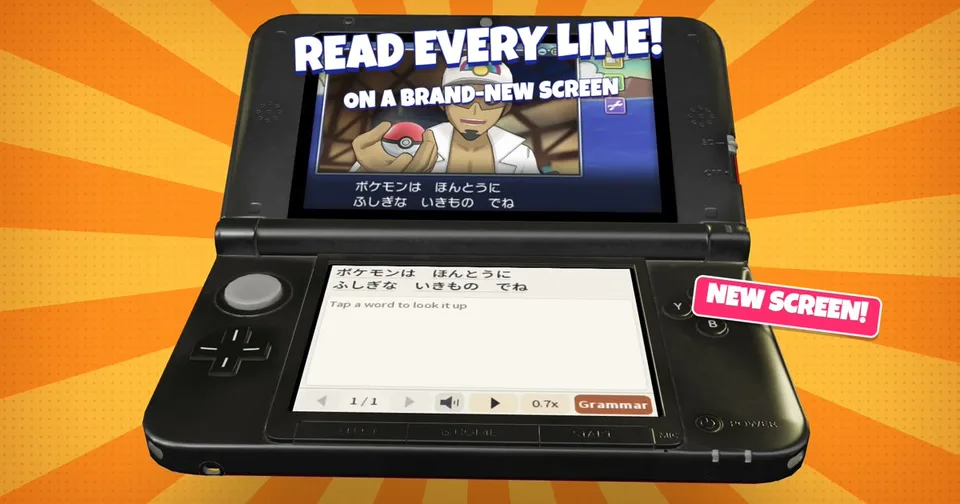

# ImmersionMode

Pokémon Ultra Moon as a Japanese reader, on a real Nintendo 3DS.



Every line of dialogue also appears on the bottom screen while you play. Tap a word to look it
up, ask Claude about the grammar of a line, and hear the line read aloud. More at
[olliejarvis.com/immersionmode](https://www.olliejarvis.com/immersionmode).

## What's in this repo

- `payload/`: the C code that runs inside the game. Luma3DS loads it through a `code.ips` patch
  and an edited `exheader.bin`. It hooks the game's text drawing and draws the reader on the
  bottom screen.
- `tools/jpreader_tools/`: the `jpreader` command. It reads your copy of the game, builds the
  dictionary entries for every line, builds the patch, and copies it to an SD card.
- `tests/`: the Python tests, plus the payload's C tests (`payload/host_tests`), which run on your
  computer.
- `docs/`: notes and screenshots from each stage of the build.

**Not included:** the game, anything taken from it (text, fonts, sound), the voice clips and
build outputs. You need your own decrypted dump of the game.

## You need

- Pokémon Ultra Moon: the USA version 1.0 cartridge image, with no update installed.
- An Old 3DS or 2DS running Luma3DS 13.x.
- Python 3.12 or newer, and [uv](https://docs.astral.sh/uv/).
- The `arm-none-eabi` GCC toolchain, to compile the payload.
- Optional:
  - [Azahar](https://azahar-emu.org/), for trying it in an emulator.
  - API keys in `.env`: `ANTHROPIC_API_KEY` for the grammar annotations and literal
    translations, and `ELEVENLABS_API_KEY` to make voice clips.

## Build and install

```sh
uv sync
echo 'JPREADER_ROM=/path/to/ultra-moon.3ds' > .env
uv run jpreader build
uv run jpreader sd "/Volumes/<SD card name>"
```

`jpreader sd` copies the patch to `luma/titles/00040000001B5100/` and the reader's files to
`jpreader/` on the card. On the 3DS:

1. Hold **SELECT** while switching it on.
2. Tick **Enable game patching**, and press **START** to save.
3. Start the game.

To go back to the normal game, delete `luma/titles/00040000001B5100` from the card.

`uv run jpreader --help` lists the other commands: the emulator checks, the script dump and the
voice clips. `docs/hardware-test.md` is the full on-console checklist.

## Tests

```sh
uv run pytest
```

Tests marked `rom` need the game (`JPREADER_ROM` in `.env`), and tests marked `e2e` drive the
Azahar emulator.

## Credits

- Word lookups use [JMdict](https://www.edrdg.org/jmdict/j_jmdict.html) (EDRDG, CC BY-SA 4.0), via
  [jmdict-simplified](https://github.com/scriptin/jmdict-simplified), and
  [SudachiPy](https://github.com/WorksApplications/sudachi.rs) for splitting sentences into words.
- HTTPS on the 3DS uses [BearSSL](https://bearssl.org/).
- `tests/data/kaishi-ids.json` is the word list of the
  [Kaishi 1.5k](https://github.com/donkuri/kaishi) deck.

ImmersionMode is a fan project. It isn't affiliated with or endorsed by Nintendo, Game Freak or
The Pokémon Company.

## License

[MIT](LICENSE)
