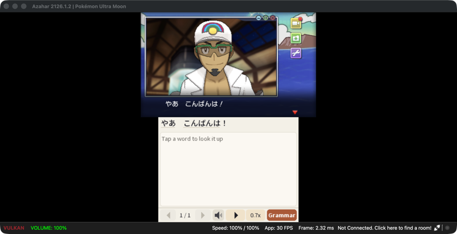

# Stage 10 results: voice acting

Result: **PASSED**

Written by `jpreader e2e stage10`. Azahar in Old 3DS mode, debug build. A new game opens with Professor Kukui's video call, system text file 38: its first line must play its own system clip. The test cannot reach the story through character creation, so after that a debug switch makes each message stand in for story file 27's lines (0 and 1 alternately); which story line has which clip is checked by the host tests. Azahar's sound output itself is not checked: the figures are the DSP's own progress.

## Checks

| Check | Result | Detail |
|---|---|---|
| the opening call's first line plays its system clip | pass | archive 30 file 38 line 1: clip 9397, voice.bin key ('0x8026', 1), DSP active 1 |
| its samples come from a later voice part | pass | 4 of 4 buffers match voice-4.bin byte for byte; voice.bin has 6 parts |
| ▶ replays it | pass | starts 1 -> 2 |
| voice.bin is read | pass | fault 0 |
| a message's clip plays as its box opens | pass | clip 299, samples read 38584 -> 49608 of 127008, DSP active 1 |
| the DSP is fed the clip's own samples | pass | ring at 0x34184000: 4 of 4 buffers match voice-0.bin byte for byte |
| the panel offers the buttons | pass | voice_available 1 |
| the next message's clip replaces it | pass | clip 299 -> 300, starts 3 -> 4 |
| ▶ replays the clip from the start | pass | starts 4 -> 5, speed 0, read 27560/123480 |
| 0.7x replays the slow version | pass | speed 1, 176232 samples = 1.43x the normal 123480 |
| the slow clip plays | pass | DSP active 1, read 27560 |
| voice=0 stops autoplay | pass | starts 0, buttons offered 1 |
| ▶ still plays with voice=0 | pass | starts 1 |

## Screenshots



## Log

```
PASS the opening call's first line plays its system clip: archive 30 file 38 line 1: clip 9397, voice.bin key ('0x8026', 1), DSP active 1
PASS its samples come from a later voice part: 4 of 4 buffers match voice-4.bin byte for byte; voice.bin has 6 parts
PASS ▶ replays it: starts 1 -> 2
PASS voice.bin is read: fault 0
PASS a message's clip plays as its box opens: clip 299, samples read 38584 -> 49608 of 127008, DSP active 1
PASS the DSP is fed the clip's own samples: ring at 0x34184000: 4 of 4 buffers match voice-0.bin byte for byte
PASS the panel offers the buttons: voice_available 1
PASS the next message's clip replaces it: clip 299 -> 300, starts 3 -> 4
PASS ▶ replays the clip from the start: starts 4 -> 5, speed 0, read 27560/123480
PASS 0.7x replays the slow version: speed 1, 176232 samples = 1.43x the normal 123480
PASS the slow clip plays: DSP active 1, read 27560
voice=0 is read with config.txt; it is read once a session, so this run restarts the game for it
PASS voice=0 stops autoplay: starts 0, buttons offered 1
PASS ▶ still plays with voice=0: starts 1
```
