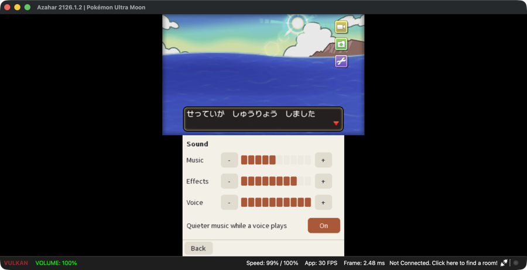

# Stage 11 results: the sound mixer

Result: **PASSED**

Written by `jpreader e2e stage11`. Azahar in Old 3DS mode, debug build. The figures are the game's own nw::snd player volumes, read from its memory (players 0 and 1 are the music, 2 to 11 the effects and cries), and our voice's nn::snd volume. As in stage 10, a debug switch makes each message stand in for story file 27, so a clip plays. Azahar's sound output itself is not checked.

## Checks

| Check | Result | Detail |
|---|---|---|
| sound.txt is read | pass | music 5, effects 8, voice 10, duck 1 |
| the music plays at its level | pass | players 0-1: 0.250 0.250 (music 5 = 0.25) |
| the effects and cries play at theirs | pass | players 2-11: 0.640 0.640 0.640 0.640 0.640 0.640 0.640 0.640 0.640 0.640 (effects 8 = 0.64) |
| the music ducks under a voice clip | pass | duck 400, players 0-1: 0.100 0.100, 2-11 0.640… |
| our voice plays at its level | pass | voice volume 1.000 (voice 10 = 1.0) |
| the music comes back after the clip | pass | players 0-1: 0.250 0.250 |
| the game's own set keeps its value and ours rides on it | pass | ChangeBGMPlayerVolume(0.5): sets 0 -> 2, the game's 0.5 kept, players 0-1 0.125 0.125 (0.5 x 0.25), 2-11 unchanged |
| a game fade starts from its own value and lands at ours | pass | a 30-tick fade to 1.0: gets 0 -> 2, sets 62, players 0-1 0.250 0.250 |
| the speaker button opens the Sound view | pass | open 1 |
| Music + raises the music at once | pass | music 6, players 0-1: 0.360 0.360 (music 6 = 0.36) |
| the voice level sets our voice's volume | pass | voice 5, volume 0.250 (voice 5 = 0.25) |
| Back writes sound.txt | pass | saves 0 -> 1, file 'music=06\neffects=08\nvoice=05\nduck=1' |

## Screenshots



## Log

```
PASS sound.txt is read: music 5, effects 8, voice 10, duck 1
PASS the music plays at its level: players 0-1: 0.250 0.250 (music 5 = 0.25)
PASS the effects and cries play at theirs: players 2-11: 0.640 0.640 0.640 0.640 0.640 0.640 0.640 0.640 0.640 0.640 (effects 8 = 0.64)
PASS the music ducks under a voice clip: duck 400, players 0-1: 0.100 0.100, 2-11 0.640…
PASS our voice plays at its level: voice volume 1.000 (voice 10 = 1.0)
PASS the music comes back after the clip: players 0-1: 0.250 0.250
the game's own player-volume calls so far: 0 sets, 0 gets (through the replaced functions)
PASS the game's own set keeps its value and ours rides on it: ChangeBGMPlayerVolume(0.5): sets 0 -> 2, the game's 0.5 kept, players 0-1 0.125 0.125 (0.5 x 0.25), 2-11 unchanged
PASS a game fade starts from its own value and lands at ours: a 30-tick fade to 1.0: gets 0 -> 2, sets 62, players 0-1 0.250 0.250
PASS the speaker button opens the Sound view: open 1
PASS Music + raises the music at once: music 6, players 0-1: 0.360 0.360 (music 6 = 0.36)
PASS the voice level sets our voice's volume: voice 5, volume 0.250 (voice 5 = 0.25)
PASS Back writes sound.txt: saves 0 -> 1, file 'music=06\neffects=08\nvoice=05\nduck=1'
```
