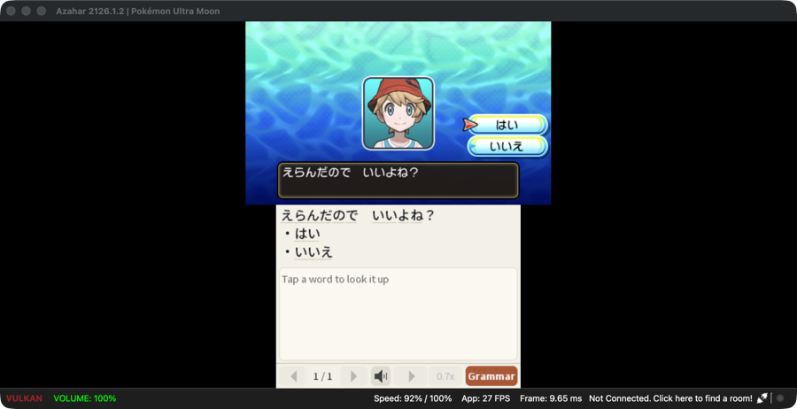
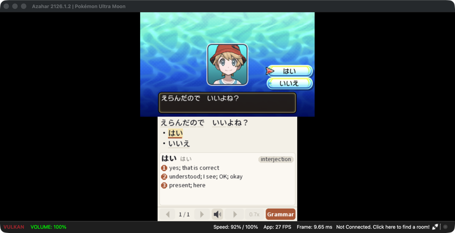

# Stage 12 results: choice menus

Result: **PASSED**

Written by `jpreader e2e stage12`. Azahar in Old 3DS mode, debug build. The opening's photo prompt (えらんだので いいよね？) is an app menu (app::tool::MenuWindow) under a talk window, with options from message data built in memory; it is the menu the emulator can reach. Field menus (App::Tool::ListMenu: NPC questions, script choices) come after the opening and are checked on the console (docs/hardware-test.md).

## Checks

| Check | Result | Detail |
|---|---|---|
| a menu under a question is captured | pass | menus 2, options 2, under えらんだので　いいよね？ |
| each option's words are found | pass | 2 of 2 options |
| the panel shows the options under the question | pass | visible 1, units 8 |
| an option's word can be looked up | pass | selected 7 at 14, card status 1 |
| choosing hides the options | pass | showing 0 after A (menus 2) |

## Screenshots




## Log

```
#1 せっていが　しゅうりょう　しました
#2 アローラちほうの/ククイはかせ　から　れんらくです
#3 ちょっと　まって……
#4 やあ　こんばんは！
#5 アローラに　ひっこしする　ひが/いよいよ　ちかづいてきたね！
#6 アローラは　いくつかの　しまが/あつまって　できている　ちほう
#7 それが　りゆう　なのか/めずらしい　ポケモン　ばかりだぜ！
#8 そう　アローラにも　ポケットモンスター/ちぢめて　ポケモンが　たくさんいる！
#9 ポケモンは　ほんとうに/ふしぎな　いきもの　でね
#10 くさむらや　どうくつ　そら　うみ……/いたるところに　いて
#11 ぼくたちは　ポケモンの/ちからをかりたり　たすけあったり
#12 ポケモントレーナー　として/ポケモンを　たたかわせたりするんだ！
#13 イワンコに　アブリー！　あとで/あそぶからね　まっててくれるかい？
#14 さて　みんなに　しょうかい　するから/あらためて　きみのことを　きくぜ！
#15 どの　しゃしんが　いいか/おしえて　くれるかな？
#16 えらんだので　いいよね？
PASS a menu under a question is captured: menus 2, options 2, under えらんだので　いいよね？
PASS each option's words are found: 2 of 2 options
PASS the panel shows the options under the question: visible 1, units 8
PASS an option's word can be looked up: selected 7 at 14, card status 1
PASS choosing hides the options: showing 0 after A (menus 2)
```
