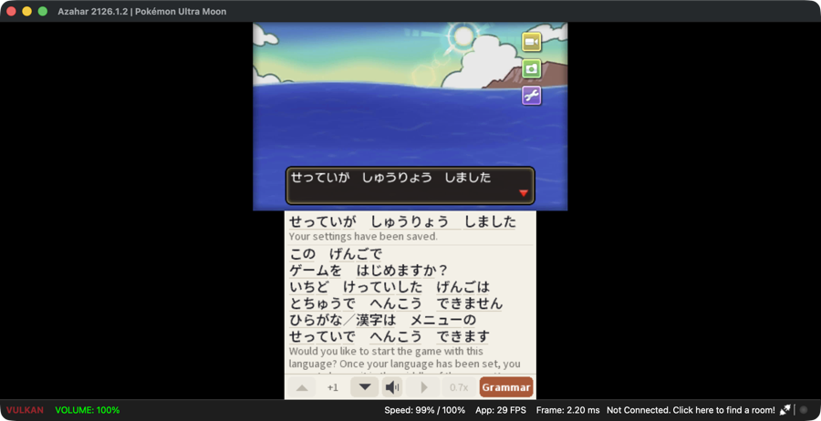

# Stage 13 results: the peek

Result: **PASSED**

Written by `jpreader e2e stage13`. Azahar in Old 3DS mode, debug build. SELECT is pressed through a debug switch (the emulator's buttons are not the driver's); that the payload finds the HID word real SELECT is read from is checked. The emulator cannot reach a battle from a new game in a test's time, so the battle content (moves, the battle's messages, the command labels) is checked on the console (docs/hardware-test.md); here the peek shows the field's latest message.

## Checks

| Check | Result | Detail |
|---|---|---|
| the HID word SELECT is read from is found | pass | at 0x334b7aa0 |
| SELECT is kept apart from START | pass | nn::hid's select flag 1 |
| SELECT opens the peek | pass | open 1, visible 1, composed 1 |
| the game sees no buttons while it is open | pass | messages 1 -> 1 after three A presses |
| SELECT again closes it | pass | open 0 |
| the game has its buttons back | pass | messages 1 -> 2 |

## Screenshots



## Log

```
PASS the HID word SELECT is read from is found: at 0x334b7aa0
PASS SELECT is kept apart from START: nn::hid's select flag 1
PASS SELECT opens the peek: open 1, visible 1, composed 1
PASS the game sees no buttons while it is open: messages 1 -> 1 after three A presses
PASS SELECT again closes it: open 0
PASS the game has its buttons back: messages 1 -> 2
window messages seen 0, lower-screen texts 2, known 1
```
