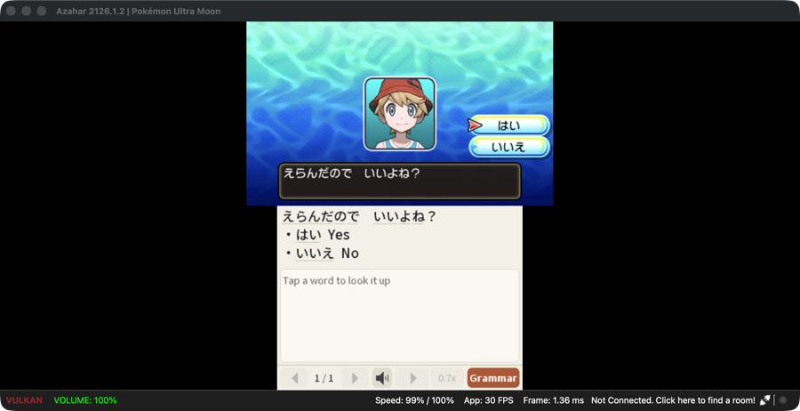

# Stage 14 results: the peek reads the screens

Result: **PASSED**

Written by `jpreader e2e stage14`. Azahar in Old 3DS mode, debug build. The test reaches the opening's photo prompt, whose はい/いいえ buttons are layout text on the upper screen, and opens the peek there (SELECT through a debug switch). Battles, the Bag and other menus are not reachable from a new game in a test's time; they are checked on the console (docs/hardware-test.md).

## Checks

| Check | Result | Detail |
|---|---|---|
| the photo prompt's options are up | pass | options 2 |
| SELECT opens the peek | pass | open 1, visible 1 |
| the walk finds the screens' texts | pass | 3 texts |
| they are listed, a line a button | pass | ・はい  Yes | ・いいえ  No |
| strings.bin knows some, with their English | pass | 2 known |
| their words can be tapped | pass | units 8 |
| SELECT again closes it | pass | open 0 |

## Screenshots



## Log

```
PASS the photo prompt's options are up: options 2
PASS SELECT opens the peek: open 1, visible 1
PASS the walk finds the screens' texts: 3 texts
PASS they are listed, a line a button: ・はい  Yes | ・いいえ  No
PASS strings.bin knows some, with their English: 2 known
PASS their words can be tapped: units 8
PASS SELECT again closes it: open 0
```
