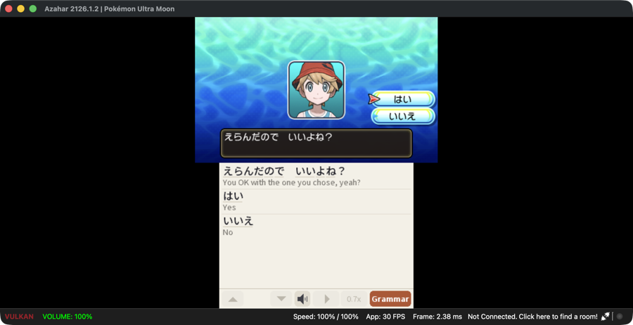
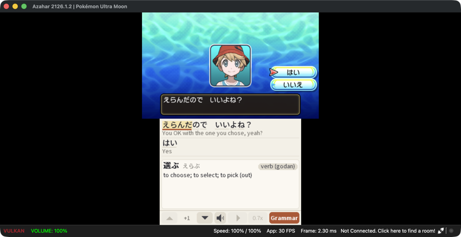

# Stage 15 results: the peek's rows

Result: **PASSED**

Written by `jpreader e2e stage15`. Azahar in Old 3DS mode, debug build. The test reaches the opening's photo prompt, whose はい/いいえ buttons are layout text on the upper screen, and opens the peek there (SELECT through a debug switch). Battles, the Bag and other menus are not reachable from a new game in a test's time; they are checked on the console (docs/hardware-test.md).

## Checks

| Check | Result | Detail |
|---|---|---|
| the photo prompt's options are up | pass | options 2 |
| SELECT opens the peek | pass | open 1, visible 1 |
| the message heads the rows | pass | えらんだので　いいよね？ [|You OK with the one you chose, yeah?||] | はい [|Yes||] | いいえ [|No||] |
| a row a button: はい and いいえ | pass | えらんだので　いいよね？ [|You OK with the one you chose, yeah?||] | はい [|Yes||] | いいえ [|No||] |
| each with its English from strings.bin | pass | 2 known |
| their words can be tapped | pass | units 8 |
| a tapped word opens its card | pass | y 10, unit 1, entry 166, card 1 |
| tapping it again closes the card | pass | unit 0 |
| SELECT again closes the peek | pass | open 0 |

## Screenshots




## Log

```
PASS the photo prompt's options are up: options 2
PASS SELECT opens the peek: open 1, visible 1
PASS the message heads the rows: えらんだので　いいよね？ [|You OK with the one you chose, yeah?||] | はい [|Yes||] | いいえ [|No||]
PASS a row a button: はい and いいえ: えらんだので　いいよね？ [|You OK with the one you chose, yeah?||] | はい [|Yes||] | いいえ [|No||]
PASS each with its English from strings.bin: 2 known
PASS their words can be tapped: units 8
PASS a tapped word opens its card: y 10, unit 1, entry 166, card 1
PASS tapping it again closes the card: unit 0
PASS SELECT again closes the peek: open 0
```
