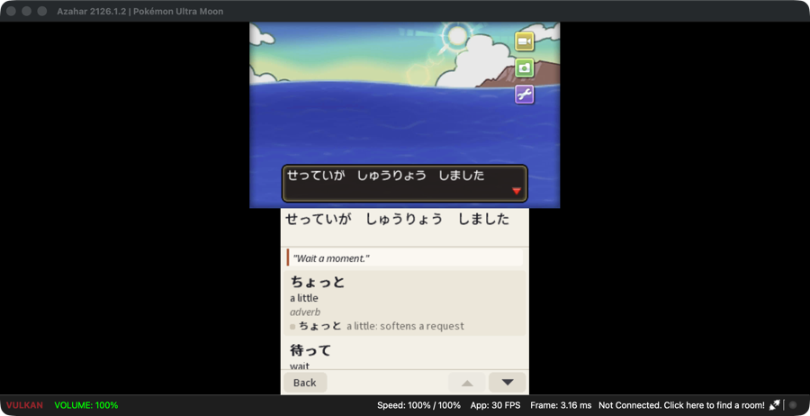
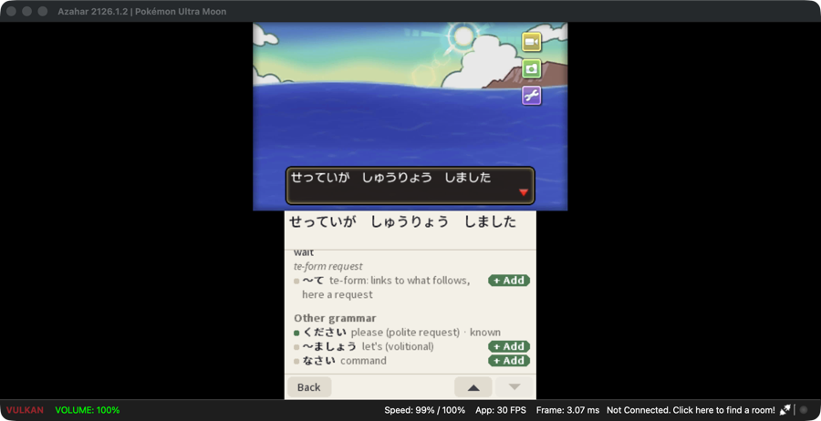
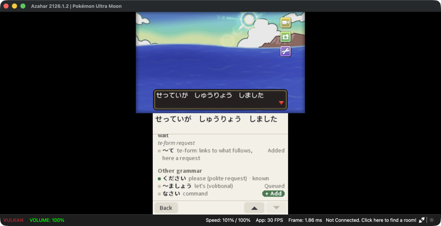
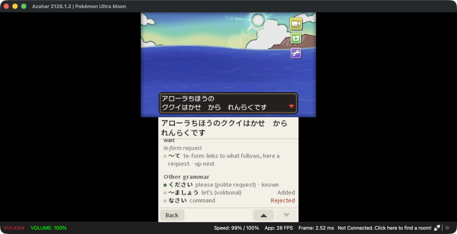

# Stage 17 results: kokoro's grammar points

Result: **PASSED**

Written by `jpreader e2e stage17`. Azahar in Old 3DS mode, debug build, kana mode, against the stand-in kokoro (`standin.py`) over HTTPS with the test CA; the real kokoro is never contacted. The stand-in's explanation has five grammar points: one with no Bunpro match under ちょっと, one kokoro lacks under 待って, and three of no chunk (one known, two kokoro lacks).

## Checks

| Check | Result | Detail |
|---|---|---|
| grammar points are rows under their chunks and in Other grammar | pass | state 2; rows 5, of no chunk 3, + Add 3; G lines in the reply 5 |
| an add online | pass | add 2; stand-in got ['bunpro:1082']; + Add left 2 |
| an add without Wi-Fi is saved for later | pass | tapped True; add 3 (kokoro failure 2); outbox 1; + Add left 1 |
| a remembered reply shows this session's adds | pass | state 2, requests 1 -> 1; rows 5, + Add 1 (added and queued points show so) |
| the saved add goes after the next request that succeeds | pass | reply 2; outbox 0; stand-in got ['bunpro:1082', 'bunpro:2000']; + Add left 1 |
| a wrong token says so | pass | add 4, HTTP 401 |

## Screenshots








## Log

```
PASS grammar points are rows under their chunks and in Other grammar: state 2; rows 5, of no chunk 3, + Add 3; G lines in the reply 5
PASS an add online: add 2; stand-in got ['bunpro:1082']; + Add left 2
PASS an add without Wi-Fi is saved for later: tapped True; add 3 (kokoro failure 2); outbox 1; + Add left 1
PASS a remembered reply shows this session's adds: state 2, requests 1 -> 1; rows 5, + Add 1 (added and queued points show so)
PASS the saved add goes after the next request that succeeds: reply 2; outbox 0; stand-in got ['bunpro:1082', 'bunpro:2000']; + Add left 1
PASS a wrong token says so: add 4, HTTP 401
```
