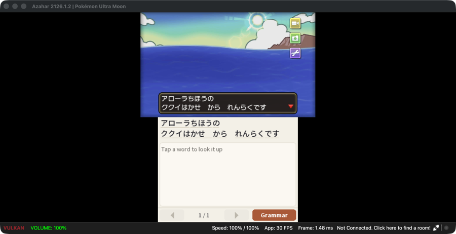
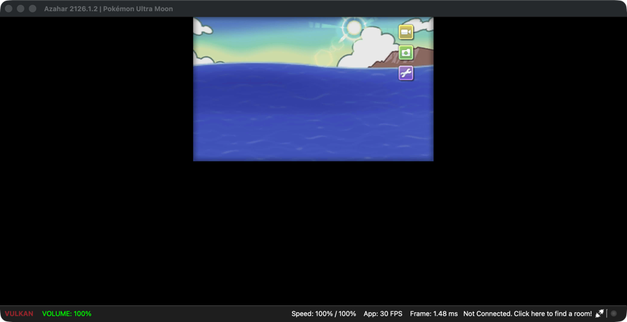

# Stage 2 results (kana)

Result: **PASSED**

Written by `jpreader e2e stage2`. Azahar in Old 3DS mode, debug build of the payload.

## Checks

| Check | Result | Detail |
|---|---|---|
| font loaded | pass | status 1, 2823 glyphs, error 0 |
| bottom-screen format | pass | 0x8051, buffer at 0x33470980 |
| drawing time | pass | worst of 10 frames 0.58 ms of CPU time (budget 2.0 ms) |
| panel on screen | pass | 11.6% of the window is panel colour |
| touch kept from the game | pass | hidden 0 → 4, passed 0 → 0 |
| ends of the message | pass | ▶ on a one-block message: view 0, taps 0 → 0 |
| panel goes away | pass | 0.01% of the window is panel colour |
| touch reaches the game when closed | pass | passed 0 → 4, hidden 8 → 8 |
| every message shown | pass | 20 messages; not shown or wrong block count: none |

## Screenshots




## Log

```
#2 shown: blocks 1/1 | アローラちほうの/ククイはかせ　から　れんらくです
PASS font loaded: status 1, 2823 glyphs, error 0
PASS bottom-screen format: 0x8051, buffer at 0x33470980
PASS drawing time: worst of 10 frames 0.58 ms of CPU time (budget 2.0 ms)
PASS panel on screen: 11.6% of the window is panel colour
PASS touch kept from the game: hidden 0 → 4, passed 0 → 0
PASS ends of the message: ▶ on a one-block message: view 0, taps 0 → 0
PASS panel goes away: 0.01% of the window is panel colour
PASS touch reaches the game when closed: passed 0 → 4, hidden 8 → 8
#3 shown: blocks 1/1 | ちょっと　まって……
#4 shown: blocks 1/1 | やあ　こんばんは！
#5 shown: blocks 1/1 | アローラに　ひっこしする　ひが/いよいよ　ちかづいてきたね！
#6 shown: blocks 1/1 | アローラは　いくつかの　しまが/あつまって　できている　ちほう
#7 shown: blocks 1/1 | それが　りゆう　なのか/めずらしい　ポケモン　ばかりだぜ！
#8 shown: blocks 1/1 | そう　アローラにも　ポケットモンスター/ちぢめて　ポケモンが　たくさんいる！
#9 shown: blocks 1/1 | ポケモンは　ほんとうに/ふしぎな　いきもの　でね
#10 shown: blocks 1/1 | くさむらや　どうくつ　そら　うみ……/いたるところに　いて
#11 shown: blocks 1/1 | ぼくたちは　ポケモンの/ちからをかりたり　たすけあったり
#12 shown: blocks 1/1 | ポケモントレーナー　として/ポケモンを　たたかわせたりするんだ！
#13 shown: blocks 1/1 | イワンコに　アブリー！　あとで/あそぶからね　まっててくれるかい？
#14 shown: blocks 1/1 | さて　みんなに　しょうかい　するから/あらためて　きみのことを　きくぜ！
#15 shown: blocks 1/1 | どの　しゃしんが　いいか/おしえて　くれるかな？
#16 shown: blocks 1/1 | えらんだので　いいよね？
#17 shown: blocks 1/1 | なまえの　とうろくも/きみに　おまかせ　するよ！
#18 shown: blocks 1/1 | いきし　で　いいかい？
#19 shown: blocks 1/1 | オーケー！/みんなに　つたえておくよ！
#20 shown: blocks 1/1 | いきし……！
#21 shown: blocks 1/1 | うん！　トロピカルキックの　ように/ごきげんな　なまえ　だぜ
PASS every message shown: 20 messages; not shown or wrong block count: none
```
