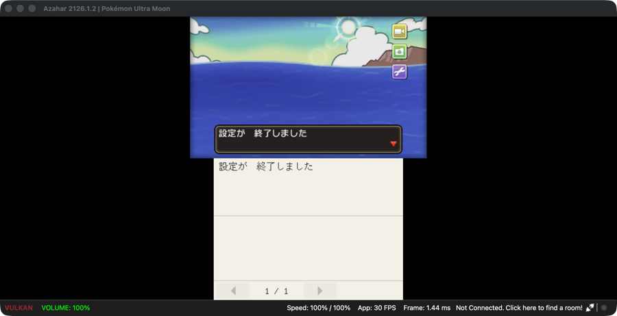
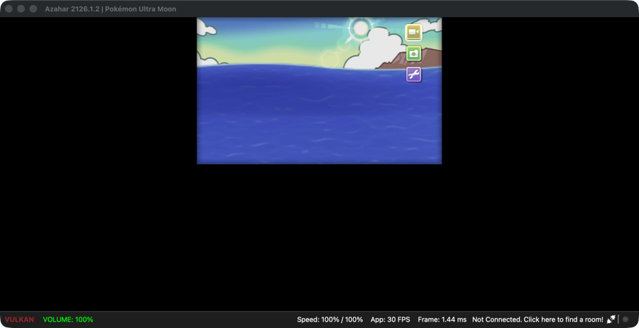

# Stage 2 results (kanji)

Result: **PASSED**

Written by `jpreader e2e stage2`. Azahar in Old 3DS mode, debug build of the payload.

## Checks

| Check | Result | Detail |
|---|---|---|
| font loaded | pass | status 1, 2229 glyphs, error 0 |
| bottom-screen format | pass | 0x8051, buffer at 0x33438480 |
| drawing time | pass | worst of 10 frames 1.45 ms of CPU time (budget 2.0 ms) |
| panel on screen | pass | 12.8% of the window is panel colour |
| touch kept from the game | pass | hidden 0 → 4, passed 0 → 0 |
| ends of the message | pass | ▶ on a one-block message: view 0, taps 0 → 0 |
| panel goes away | pass | 0.00% of the window is panel colour |
| touch reaches the game when closed | pass | passed 0 → 4, hidden 8 → 8 |
| every message shown | pass | 8 messages; not shown or wrong block count: none |
| kanji mode | pass | language byte 1, kanji seen: True |

## Screenshots




## Log

```
#1 shown: blocks 1/1 | 設定が　終了しました
PASS font loaded: status 1, 2229 glyphs, error 0
PASS bottom-screen format: 0x8051, buffer at 0x33438480
PASS drawing time: worst of 10 frames 1.45 ms of CPU time (budget 2.0 ms)
PASS panel on screen: 12.8% of the window is panel colour
PASS touch kept from the game: hidden 0 → 4, passed 0 → 0
PASS ends of the message: ▶ on a one-block message: view 0, taps 0 → 0
#2 shown: blocks 1/1 | アローラ地方の/ククイ博士から　連絡です
PASS panel goes away: 0.00% of the window is panel colour
PASS touch reaches the game when closed: passed 0 → 4, hidden 8 → 8
#3 shown: blocks 1/1 | ちょっと　待って……
#4 shown: blocks 1/1 | やあ　こんばんは！
#5 shown: blocks 1/1 | アローラに　引越しする　日が/いよいよ　ちかづいてきたね！
#6 shown: blocks 1/1 | アローラは　いくつかの　島が/集まって　できている　地方
#7 shown: blocks 1/1 | それが　理由なのか/珍しい　ポケモン　ばかりだぜ！
#8 shown: blocks 1/1 | そう　アローラにも　ポケットモンスター/縮めて　ポケモンが　たくさんいる！
PASS every message shown: 8 messages; not shown or wrong block count: none
PASS kanji mode: language byte 1, kanji seen: True
```
