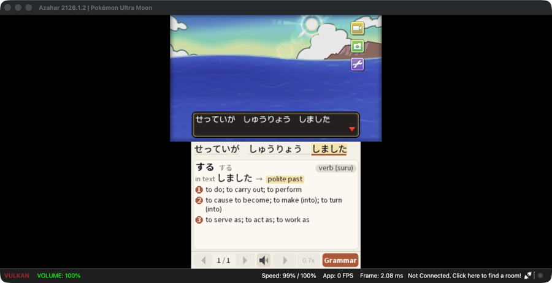
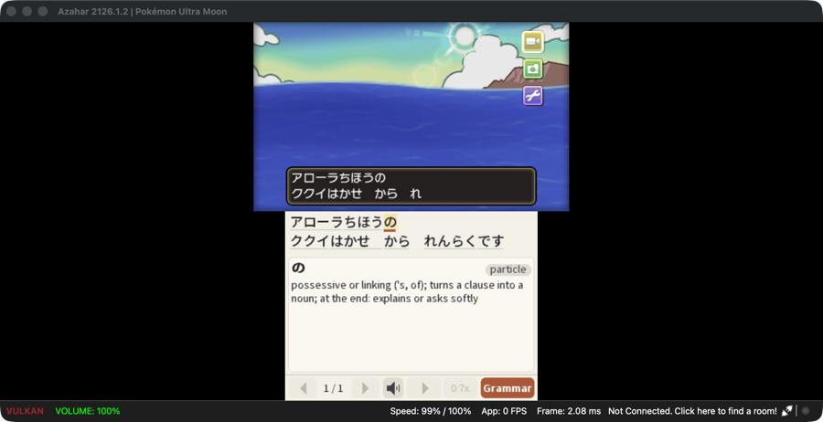

# Stage 3B results (kana)

Result: **PASSED**

Written by `jpreader e2e stage3`. Azahar in Old 3DS mode, debug build of the payload.

## Checks

| Check | Result | Detail |
|---|---|---|
| data files open | pass | status 1, error 0x0 |
| drawing time with a card | pass | worst of 10 frames 0.63 ms of CPU time (budget 2.0 ms) |
| units match the build | pass | 20 of 20 messages agree; differing: none |
| lines found | pass | 19 of 19 lines with words placed in the displayed text (100%) |
| words selected by tapping | pass | #1 しました: selected 4/4 at 13/13, entry 15/15, card 1; #2 の: selected 3/3 at 7/7, entry 23/23, card 1; #3 まって: selected 2/2 at 5/5, entry 333/333, card 1 |
| cards read | pass | 3 of 3 cards read |

## Lines by outcome

| Outcome | Messages |
|---|---|
| found | 19 |
| no words | 1 |

## Screenshots




## Log

```
PASS data files open: status 1, error 0x0
#1 found, 4 units (host: found, 4) | せっていが　しゅうりょう　しました
tap #1 at (235, 14) on しました: #1 しました: selected 4/4 at 13/13, entry 15/15, card 1
PASS drawing time with a card: worst of 10 frames 0.63 ms of CPU time (budget 2.0 ms)
#2 found, 8 units (host: found, 8) | アローラちほうの/ククイはかせ　から　れんらくです
tap #2 at (133, 14) on の: #2 の: selected 3/3 at 7/7, entry 23/23, card 1
#3 found, 2 units (host: found, 2) | ちょっと　まって……
tap #3 at (99, 14) on まって: #3 まって: selected 2/2 at 5/5, entry 333/333, card 1
#4 found, 2 units (host: found, 2) | やあ　こんばんは！
#5 found, 9 units (host: found, 9) | アローラに　ひっこしする　ひが/いよいよ　ちかづいてきたね！
#6 found, 10 units (host: found, 10) | アローラは　いくつかの　しまが/あつまって　できている　ちほう
#7 found, 11 units (host: found, 11) | それが　りゆう　なのか/めずらしい　ポケモン　ばかりだぜ！
#8 found, 11 units (host: found, 11) | そう　アローラにも　ポケットモンスター/ちぢめて　ポケモンが　たくさんいる！
#9 found, 9 units (host: found, 9) | ポケモンは　ほんとうに/ふしぎな　いきもの　でね
#10 found, 9 units (host: found, 9) | くさむらや　どうくつ　そら　うみ……/いたるところに　いて
#11 found, 11 units (host: found, 11) | ぼくたちは　ポケモンの/ちからをかりたり　たすけあったり
#12 found, 10 units (host: found, 10) | ポケモントレーナー　として/ポケモンを　たたかわせたりするんだ！
#13 found, 11 units (host: found, 11) | イワンコに　アブリー！　あとで/あそぶからね　まっててくれるかい？
#14 found, 13 units (host: found, 13) | さて　みんなに　しょうかい　するから/あらためて　きみのことを　きくぜ！
#15 found, 9 units (host: found, 9) | どの　しゃしんが　いいか/おしえて　くれるかな？
#16 found, 6 units (host: found, 6) | えらんだので　いいよね？
#17 found, 9 units (host: found, 9) | なまえの　とうろくも/きみに　おまかせ　するよ！
#18 found, 4 units (host: found, 4) | いきし　で　いいかい？
#19 found, 5 units (host: found, 5) | オーケー！/みんなに　つたえておくよ！
#20 no words, 0 units (host: no words, 0) | いきし……！
PASS units match the build: 20 of 20 messages agree; differing: none
PASS lines found: 19 of 19 lines with words placed in the displayed text (100%)
PASS words selected by tapping: #1 しました: selected 4/4 at 13/13, entry 15/15, card 1; #2 の: selected 3/3 at 7/7, entry 23/23, card 1; #3 まって: selected 2/2 at 5/5, entry 333/333, card 1
PASS cards read: 3 of 3 cards read
```
