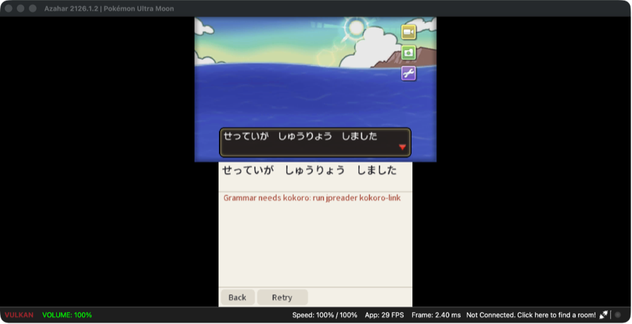
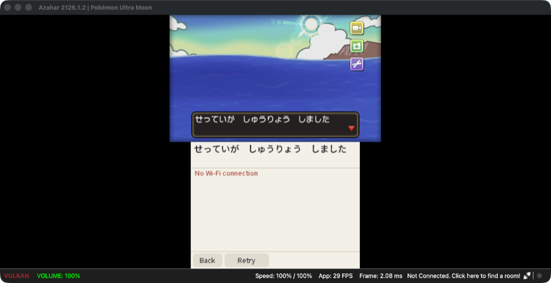
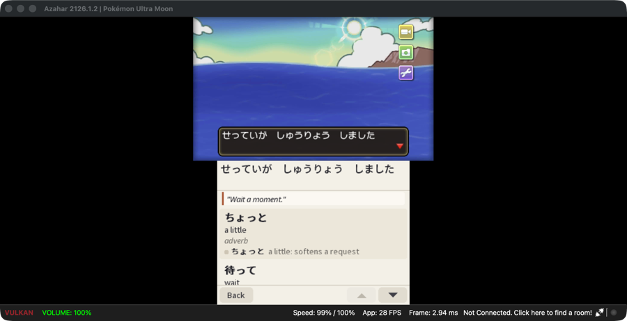

# Stage 4 results

Result: **PASSED**

Written by `jpreader e2e stage4`. Azahar in Old 3DS mode, debug build, kana mode. Grammar asks the stand-in kokoro over HTTPS (never the real kokoro).

## Checks

| Check | Result | Detail |
|---|---|---|
| every message of spec 9.4 | pass | 10 of 10 rows shown as specified |
| a reply within 15 s | pass | state 2 after 0.4 s; 310 bytes; stand-in asked 1 time(s) |
| the reply is in the tagged format | pass | first line: 'T "Wait a moment."'; 2 chunks; 5 grammar points kept (stage 17) |
| scrolling | pass | down: 54 px (three rows, or less at the end of the reply; 0 when it fits), up: 0 px |
| the stored reply comes back | pass | after Back: open 0; Grammar again: state 2, requests 10 -> 10 |
| a reply is remembered on the SD card | pass | Grammar again after forgetting: state 2, requests 10 -> 10; replies.bin 374187 bytes |
| Back cancels a request | pass | state 2, requests 10 -> 12, result id 12 -> 14 |
| a reply through the game's Wi-Fi connection sequence | pass | fault CONNECT: state 2, failure 0, code 0 |
| debug=1 logs each step to jpreader/log.txt | pass | 44 lines; connect result logged: True |
| the view outlives the dialog | pass | after the dialog ended: visible 1, open 1; after Back: gone True, touch samples the game saw 0 |

## Messages of spec 9.4

| Expected | Shown | How it was produced | Result |
|---|---|---|---|
| Grammar needs kokoro: run jpreader kokoro-link | Grammar needs kokoro: run jpreader kokoro-link | config.txt without kokoro_url and kokoro_token | pass |
| No Wi-Fi connection | No Wi-Fi connection | fault NO_WIFI (Azahar always reports Wi-Fi) | pass |
| Network is busy (the game is online) | Network is busy (the game is online) | fault BUSY | pass |
| Could not reach kokoro (code 4 | Could not reach kokoro (code 4014) | fault REFUSED: a real refused connection to 127.0.0.1:1 | pass |
| Could not verify kokoro (check the console's date) | Could not verify kokoro (check the console's date) | fault CLOCK: a real certificate check against 2000-01-01 | pass |
| Token rejected: run jpreader kokoro-link | Token rejected: run jpreader kokoro-link | the stand-in, asked with the token kkr_wrong | pass |
| kokoro is busy, try again soon | kokoro is busy, try again soon | fault STATUS 429 on a real response | pass |
| kokoro could not explain that, try again | kokoro could not explain that, try again | the stand-in answering 500 | pass |
| Timed out | Timed out | fault TIMEOUT: a real 1 ms time limit | pass |
| Could not reach kokoro (code 5900) | Could not reach kokoro (code 5900) | fault NO_ENTROPY: ssl:C gives no random bytes, so TLS must not start | pass |

## Screenshots





## Log

```
PASS row: 'Grammar needs kokoro: run jpreader kokoro-link' (failure 1, HTTP 0) via config.txt without kokoro_url and kokoro_token
PASS row: 'No Wi-Fi connection' (failure 2, HTTP 0) via fault NO_WIFI (Azahar always reports Wi-Fi)
PASS row: 'Network is busy (the game is online)' (failure 3, HTTP 0) via fault BUSY
PASS row: 'Could not reach kokoro (code 4014)' (failure 4, HTTP 0) via fault REFUSED: a real refused connection to 127.0.0.1:1
PASS row: "Could not verify kokoro (check the console's date)" (failure 5, HTTP 0) via fault CLOCK: a real certificate check against 2000-01-01
PASS row: 'Token rejected: run jpreader kokoro-link' (failure 6, HTTP 401) via the stand-in, asked with the token kkr_wrong
PASS row: 'kokoro is busy, try again soon' (failure 6, HTTP 429) via fault STATUS 429 on a real response
PASS row: 'kokoro could not explain that, try again' (failure 6, HTTP 500) via the stand-in answering 500
PASS row: 'Timed out' (failure 7, HTTP 0) via fault TIMEOUT: a real 1 ms time limit
PASS row: 'Could not reach kokoro (code 5900)' (failure 4, HTTP 0) via fault NO_ENTROPY: ssl:C gives no random bytes, so TLS must not start
PASS every message of spec 9.4: 10 of 10 rows shown as specified
PASS a reply within 15 s: state 2 after 0.4 s; 310 bytes; stand-in asked 1 time(s)
PASS the reply is in the tagged format: first line: 'T "Wait a moment."'; 2 chunks; 5 grammar points kept (stage 17)
reply: T "Wait a moment." / C ちょっと / M a little / N adverb / G -	none	ちょっと	a little: softens a request / C 待って / M wait / N te-form request / G bunpro:1082	none	〜て	te-form: links to what follows, here a request / G bunpro:31	known	ください	please (polite request) / G bunpro:2000	none	〜ましょう	let's (volitional) /
PASS scrolling: down: 54 px (three rows, or less at the end of the reply; 0 when it fits), up: 0 px
PASS the stored reply comes back: after Back: open 0; Grammar again: state 2, requests 10 -> 10
PASS a reply is remembered on the SD card: Grammar again after forgetting: state 2, requests 10 -> 10; replies.bin 374187 bytes
PASS Back cancels a request: state 2, requests 10 -> 12, result id 12 -> 14
PASS a reply through the game's Wi-Fi connection sequence: fault CONNECT: state 2, failure 0, code 0
PASS debug=1 logs each step to jpreader/log.txt: 44 lines; connect result logged: True
PASS the view outlives the dialog: after the dialog ended: visible 1, open 1; after Back: gone True, touch samples the game saw 0
```
