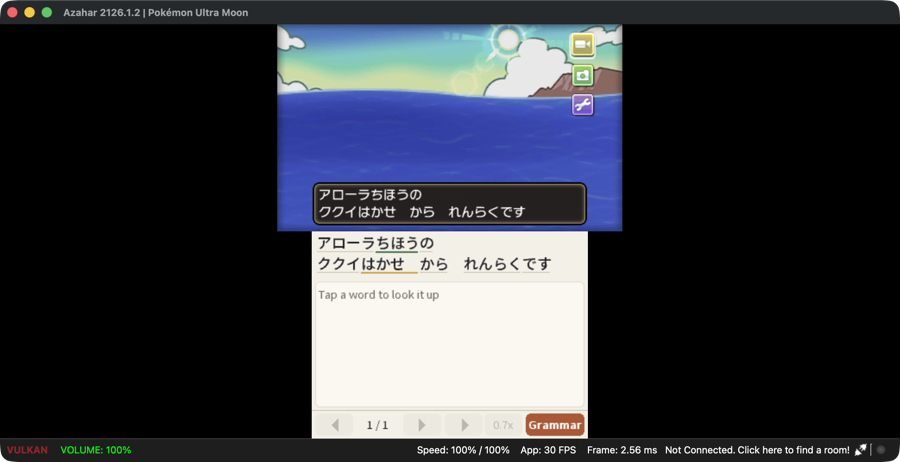
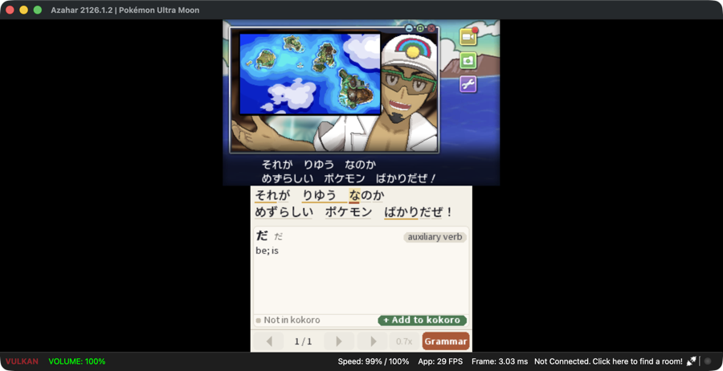
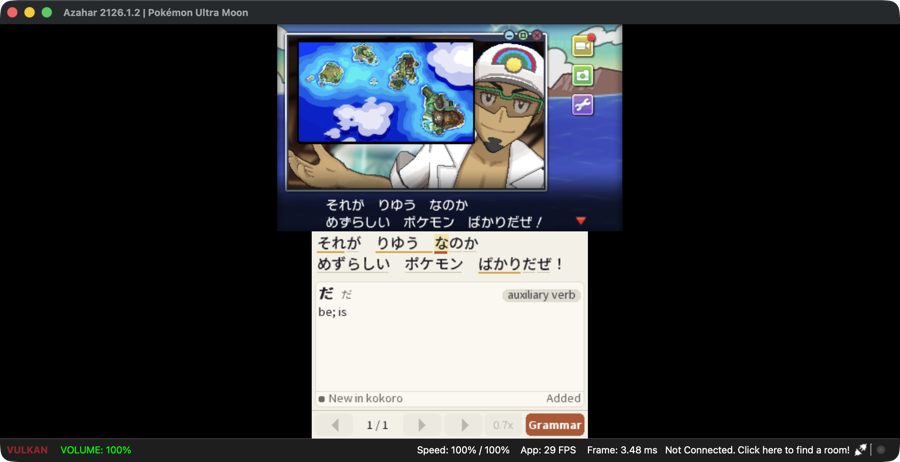

# Stage 8B results

Result: **PASSED**

Written by `jpreader e2e stage8b`, which stage 9C replaced with `jpreader e2e stage9` (the payload now reads the v2 list by JMdict id; see stage9c-results.md). Azahar in Old 3DS mode, debug build, kana mode, against the stand-in kokoro (`standin.py`) over HTTPS with the test CA; the real kokoro is never contacted.

## Checks

| Check | Result | Detail |
|---|---|---|
| kokoro's memory block | pass | at 0xfe10000 |
| the word list syncs at the first dialog | pass | 6989 of 6989 words; stand-in saw ['GET /jpreader/words 200'] |
| the list is kept on the SD card | pass | kokoro.bin 27972 bytes |
| underlines follow kokoro's states | pass | #1 (3, 0)/(3, 0); #2 (1, 1)/(1, 1); #3 (0, 1)/(0, 1); #4 (2, 0)/(2, 0); #5 (3, 0)/(3, 0) |
| adding a word | pass | だ: add 2, card 1; stand-in got {'front': 'だ', 'reading': 'だ', 'meaning': 'be; is', 'pos': 'auxiliary verb', 'sentence': 'それが\u3000りゆう\u3000なのかめずらしい\u3000ポケモン\u3000ばかりだぜ！'} |
| an add without Wi-Fi is saved for later | pass | たち: add 3, outbox 1 |
| saved adds go after the next request succeeds | pass | add 2; outbox 0; たち sent True; syncs 2 |
| a wrong token says so | pass | add 4, HTTP 401 |

## Screenshots





## Log

```
PASS kokoro's memory block: at 0xfe10000
PASS the word list syncs at the first dialog: 6989 of 6989 words; stand-in saw ['GET /jpreader/words 200']
PASS the list is kept on the SD card: kokoro.bin 27972 bytes
PASS underlines follow kokoro's states: #1 (3, 0)/(3, 0); #2 (1, 1)/(1, 1); #3 (0, 1)/(0, 1); #4 (2, 0)/(2, 0); #5 (3, 0)/(3, 0)
PASS adding a word: だ: add 2, card 1; stand-in got {'front': 'だ', 'reading': 'だ', 'meaning': 'be; is', 'pos': 'auxiliary verb', 'sentence': 'それが\u3000りゆう\u3000なのかめずらしい\u3000ポケモン\u3000ばかりだぜ！'}
PASS an add without Wi-Fi is saved for later: たち: add 3, outbox 1
PASS saved adds go after the next request succeeds: add 2; outbox 0; たち sent True; syncs 2
PASS a wrong token says so: add 4, HTTP 401
```
