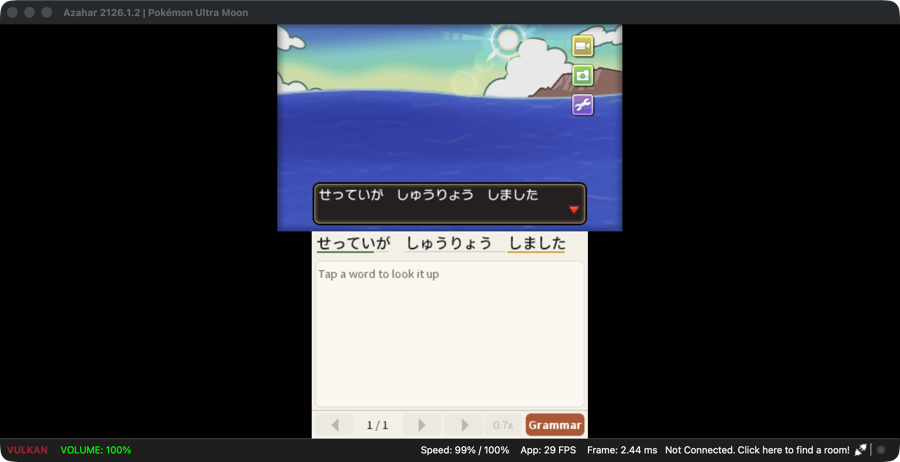
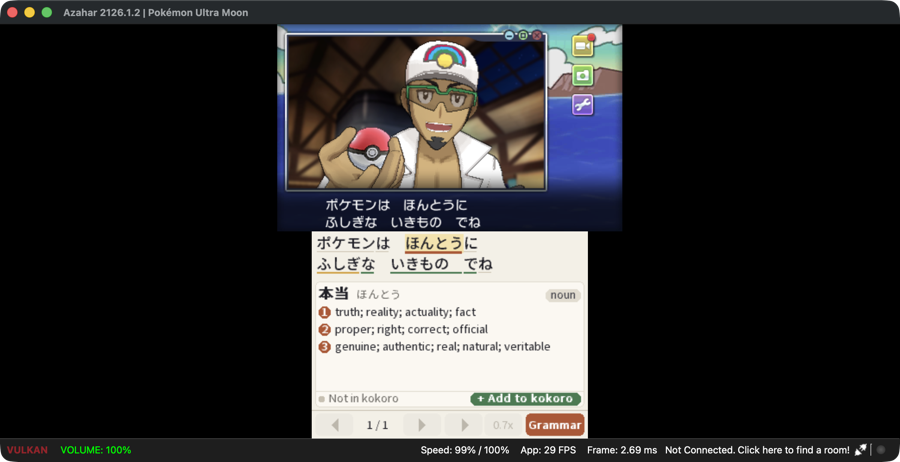
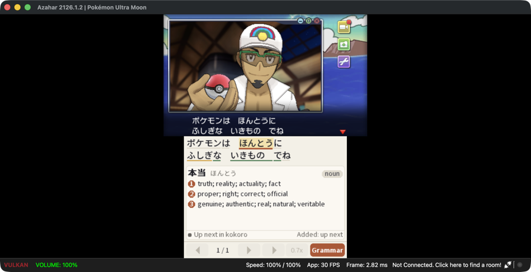
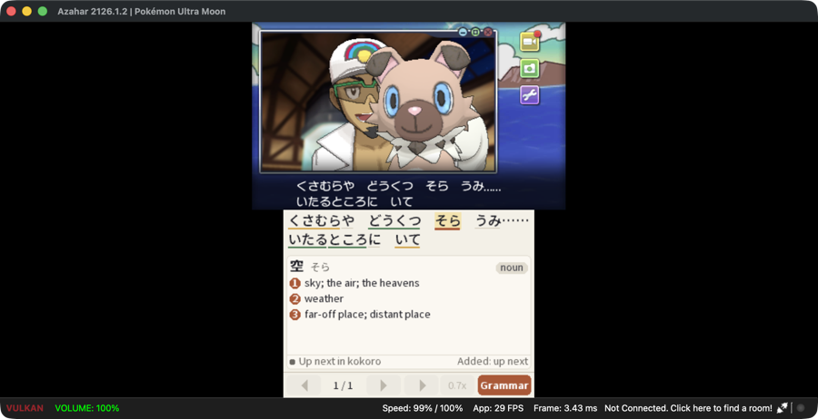

# Stage 9C results

Result: **PASSED**

Written by `jpreader e2e stage9`. Azahar in Old 3DS mode, debug build, kana mode, against the stand-in kokoro (`standin.py`, protocol v2) over HTTPS with the test CA; the real kokoro is never contacted.

## Checks

| Check | Result | Detail |
|---|---|---|
| kokoro's memory block | pass | at 0xfe10000 |
| the v2 word list syncs at the first dialog | pass | 6815 of 6815 words (40 by spelling); stand-in saw ['GET /jpreader/words?v=2 200'] |
| the list is kept on the SD card | pass | kokoro.bin 27280 bytes |
| underlines follow kokoro's states by id | pass | #1 (1, 1)/(1, 1); #2 (1, 1)/(1, 1); #3 (1, 0)/(1, 0); #4 (0, 0)/(0, 0); #5 (1, 3)/(1, 3); #6 (2, 1)/(2, 1); #7 (3, 2)/(3, 2); #8 (2, 2)/(2, 2) |
| a kana word kokoro holds only under a kanji spelling is marked | pass | 5 such units in these messages |
| an add added | pass | 本当 (1523060): add 2, card 1; stand-in answered OK added to {'jmdict': '1523060', 'front': '本当', 'reading': 'ほんとう', 'meaning': 'truth; reality; actuality; fact; proper; right; correct; official', 'pos': 'noun', 'sentence': 'ポケモンは\u3000ほんとうにふしぎな\u3000いきもの\u3000でね'} |
| an add queued | pass | 空 (1245290): add 2, card 1; stand-in answered OK queued to {'jmdict': '1245290', 'front': '空', 'reading': 'そら', 'meaning': 'sky; the air; the heavens; weather', 'pos': 'noun', 'sentence': 'くさむらや\u3000どうくつ\u3000そら\u3000うみ……いたるところに\u3000いて'} |
| an add without Wi-Fi is saved for later | pass | 海: add 3, outbox 1 |
| saved adds go, by id, after the next request succeeds | pass | add 2; outbox 0; 1201190 sent True; syncs 2 |
| a wrong token says so | pass | add 4, HTTP 401 |

## Screenshots






## Log

```
PASS kokoro's memory block: at 0xfe10000
PASS the v2 word list syncs at the first dialog: 6815 of 6815 words (40 by spelling); stand-in saw ['GET /jpreader/words?v=2 200']
PASS the list is kept on the SD card: kokoro.bin 27280 bytes
PASS underlines follow kokoro's states by id: #1 (1, 1)/(1, 1); #2 (1, 1)/(1, 1); #3 (1, 0)/(1, 0); #4 (0, 0)/(0, 0); #5 (1, 3)/(1, 3); #6 (2, 1)/(2, 1); #7 (3, 2)/(3, 2); #8 (2, 2)/(2, 2)
PASS a kana word kokoro holds only under a kanji spelling is marked: 5 such units in these messages
PASS an add added: 本当 (1523060): add 2, card 1; stand-in answered OK added to {'jmdict': '1523060', 'front': '本当', 'reading': 'ほんとう', 'meaning': 'truth; reality; actuality; fact; proper; right; correct; official', 'pos': 'noun', 'sentence': 'ポケモンは\u3000ほんとうにふしぎな\u3000いきもの\u3000でね'}
PASS an add queued: 空 (1245290): add 2, card 1; stand-in answered OK queued to {'jmdict': '1245290', 'front': '空', 'reading': 'そら', 'meaning': 'sky; the air; the heavens; weather', 'pos': 'noun', 'sentence': 'くさむらや\u3000どうくつ\u3000そら\u3000うみ……いたるところに\u3000いて'}
PASS an add without Wi-Fi is saved for later: 海: add 3, outbox 1
PASS saved adds go, by id, after the next request succeeds: add 2; outbox 0; 1201190 sent True; syncs 2
PASS a wrong token says so: add 4, HTTP 401
```
